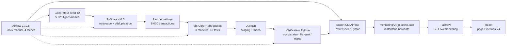

# Architecture technique — RetailMind AI V4 (démonstration locale)

## Flux de données et interface de monitoring

**Lecture :** les flèches pointillées représentent l'orchestration des étapes,
non un transfert physique de lignes. L'exporteur lit les métadonnées Airflow
et vérifie, si demandé, l'entrepôt courant. Il n'attribue pas les métriques de
l'entrepôt à chacune des anciennes exécutions.

## Composants réellement implémentés

| Couche | Rôle | Emplacement dans le dépôt |
| --- | --- | --- |
| Génération | Fixture synthétique, seed `42` | `src/retailmind/generate.py` |
| Transformation | PySpark local (`local[2]`) puis Parquet | `src/retailmind/spark_etl.py` |
| Analytics SQL | dbt-duckdb, staging + deux marts | `dbt/` |
| Contrat | Comparaison comptages, anomalies, revenu et agrégations | `scripts/verify_dbt.py` |
| Orchestration | DAG Airflow, déclenchement manuel, 4 tâches | `airflow/dags/retailmind_v4_data_pipeline.py` |
| Environnement | Java 17 + Python data séparé de Python Airflow | `docker/Dockerfile.airflow` |
| Volumes | Données V4 isolées, init des droits UID 50000 | `docker-compose.yml` |
| Préflight | Santé, versions, permissions, contrat facultatif | `scripts/check_v4_docker.py` |
| Export | États réels des runs/tâches et snapshot atomique | `scripts/export_v4_monitoring.py` |
| API | Lecture bornée du JSON, HTTP 503 en absence de snapshot | `src/retailmind/v4_monitoring.py` |
| Interface | Historique, filtres, durées, KPI et capture | `frontend/src/pages/Monitoring.tsx` |
| CI | Runner Ubuntu, Java 17, Spark → dbt → contrat | `.github/workflows/v4-data.yml` |

## Frontières d'isolation et de sécurité

- **V3** : API FastAPI, React, SQLite et ML conservent leurs propres fichiers
  et leur chaîne applicative. Ils ne sont pas remplacés par le warehouse V4.
- **V4 Airflow** : `retailmind_airflow_data` masque le répertoire `data/`
  du dépôt dans `/opt/airflow/project/data` ; le volume Docker est séparé de
  `retailmind_data` utilisé par les services V3.
- **Base Airflow** : volume `airflow_state` pour les métadonnées SQLite de la
  démonstration ; `SequentialExecutor` et une seule machine, pas de cluster.
- **Monitoring** : le script exécuté sur le PC peut appeler `docker compose`.
  FastAPI ne possède **ni socket Docker, ni identifiants Airflow**, et expose
  seulement `GET /v4/monitoring`. React n'envoie aucun trigger ou retry.
- **Réseau** : interfaces de démonstration liées à `127.0.0.1` dans Compose.
  Ne pas exposer le mot de passe de démonstration Airflow sur Internet.
- **Données** : les anomalies sont des étiquettes injectées ; aucune donnée
  personnelle ou transaction client réelle dans la fixture.

## Reproductibilité et nature des preuves

**Local Docker :** le DAG `retailmind_v4_spark_dbt_pipeline` a été observé
avec `4/4` tâches en succès. La collecte de monitoring est **à la demande** :
le front relit le fichier toutes les 60 secondes, mais **n'interroge pas
Airflow en temps réel**.

**CI GitHub Linux :** Java 17 et dépendances épinglées, fixture seed 42,
Spark réel, dbt build et tests, rapprochement, rapport JSON. Ce workflow
**ne démarre pas le serveur Airflow** : il ne doit pas être décrit comme
une preuve d'orchestration Airflow sur GitHub.

**Limites :** absence d'authentification de production et d'ordonnancement
multi-worker. Les checks Docker/CI n'établissent pas une sécurité de production.
Pour les procédures détaillées, voir [Airflow](V4_3_AIRFLOW.md),
[Docker](V4_4_DOCKER.md), [CI](V4_4_CI.md) et
[monitoring](V4_5_MONITORING.md).
