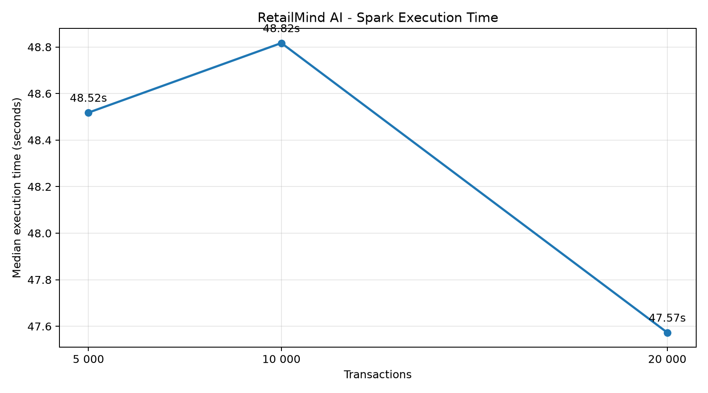
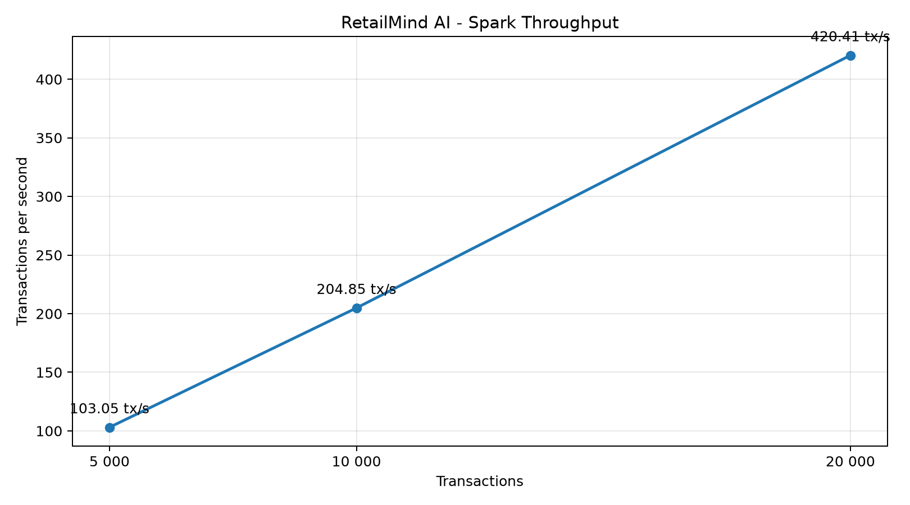
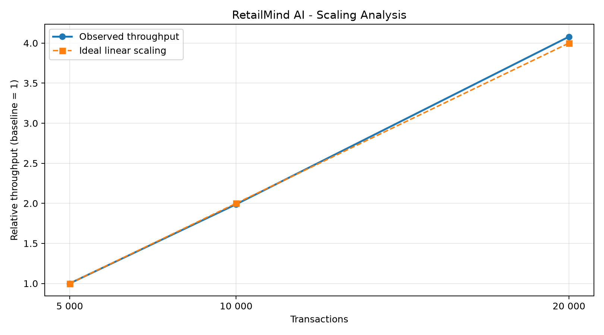

# V4.7 — Benchmark PySpark

## Objectif
Mesurer le comportement du pipeline PySpark RetailMind AI sur plusieurs volumes de données synthétiques.

## Volumes testés
- 5 000 transactions
- 10 000 transactions
- 20 000 transactions

## Méthodologie
- Génération de données synthétiques avec seed fixe
- Exécution de `retailmind.spark_etl`
- 3 exécutions par volume
- Calcul des indicateurs :
  - temps médian
  - temps moyen
  - transactions/seconde

## Résultats synthétiques

- 5 000 :
  - médiane : 48.518 s
  - moyenne : 47.234 s
  - débit : 103.05 tx/s

- 10 000 :
  - médiane : 48.817 s
  - moyenne : 49.287 s
  - débit : 204.85 tx/s

- 20 000 :
  - médiane : 47.573 s
  - moyenne : 47.855 s
  - débit : 420.41 tx/s

## Analyse
Le temps total reste globalement stable, ce qui suggère que le coût fixe de démarrage Spark domine les petits volumes.
Quand le volume augmente, le débit progresse fortement, ce qui confirme une bonne montée en charge.

## Graphiques

## Conclusion
Le pipeline PySpark RetailMind AI supporte correctement une montée de charge de 5k à 20k transactions
sans rupture fonctionnelle, avec une amélioration nette du throughput.