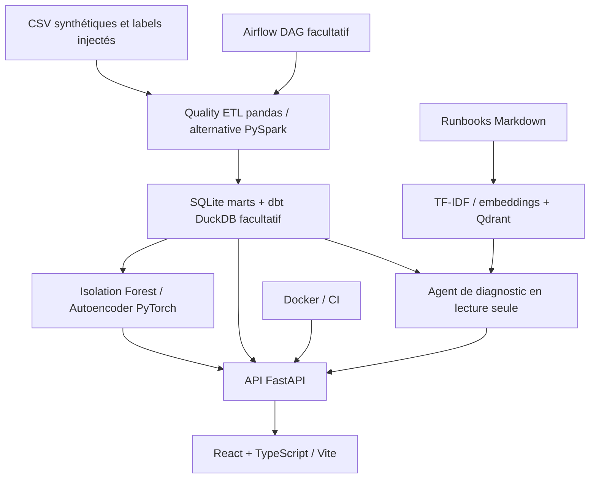

# Architecture technique — RetailMind AI

## Ports
- 8000: FastAPI, exposé sur localhost par Docker Compose
- 5173: application React/Vite en développement ; Nginx via Docker Compose
- 8080: Airflow optionnel, local uniquement
- 6333: Qdrant optionnel, local uniquement

## Choix de conception
Le parcours de base fonctionne sans clés API, GPU, Docker, Java ou services payants.
Le parcours avancé démontre PySpark, dbt, Airflow, PyTorch, LangGraph et Qdrant séparément.
L'agent ne peut que consulter le warehouse ou des documents; aucune action d'infrastructure n'est implémentée.
Les appels Ollama sont explicitement facultatifs.

## Frontend React (v2)
Le site `frontend/` est une SPA React/TypeScript construite avec Vite. En mode développement,
Vite redirige `/api/*` vers FastAPI sur `127.0.0.1:8000`. Dans Docker, Nginx sert les fichiers
statiques et relaie `/api/*` vers `api:8000`. Les routes analytiques sont en lecture seule.
Les filtres, les tris et la pagination de transactions sont implémentés côté backend SQL.
