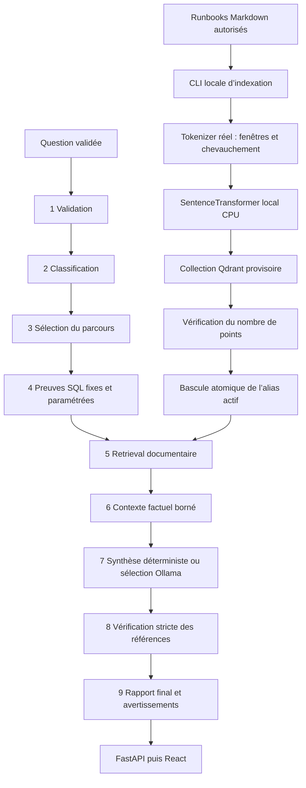

# Investigation V3 : architecture et contrats

## Avant et après

La V2 disposait de TF-IDF sur documents entiers, d’une indexation Qdrant qui supprimait
la collection existante, d’un graphe à deux nœuds et d’une sortie Ollama libre ajoutée au rapport.
La V3 conserve SQLite, les routes FastAPI, React, le système de thèmes et les modèles ML.
Elle ajoute des chunks traçables, une publication d’index par alias et neuf nœuds observables.

Le graphe est linéaire et fini. Le parcours `sql_and_docs`, `docs_only` ou `blocked`
détermine les outils autorisés dans les nœuds. Une question refusée ne déclenche aucun outil SQL,
retrieval ou LLM. Les mêmes fonctions alimentent le parcours séquentiel si LangGraph est absent.
`use_langgraph` reste compatible avec la V2 ; React le sélectionne par défaut.

## Index et embeddings

Le modèle retenu est `sentence-transformers/paraphrase-multilingual-MiniLM-L12-v2`.
La [fiche officielle](https://huggingface.co/sentence-transformers/paraphrase-multilingual-MiniLM-L12-v2)
annonce 384 dimensions et une longueur maximale de 128 tokens. Le checkpoint utilisé est
`e8f8c211226b894fcb81acc59f3b34ba3efd5f42`. Les runbooks existants sont en anglais :
le modèle multilingue permet des questions françaises sans inventer ni traduire artificiellement le corpus.

Le tokenizer du modèle fournit les offsets. Les fenêtres contiennent au plus 96 tokens de contenu,
avec un chevauchement de 16 tokens, et privilégient les frontières de paragraphes et de phrases.
La taille est plafonnée par `max_seq_length` moins les tokens spéciaux. Les dimensions et valeurs
finies des vecteurs sont vérifiées avant écriture et lors d’une recherche. Un autre modèle exige
une nouvelle indexation et doit fournir une interface SentenceTransformer et des offsets de tokenizer compatibles.
Épingler aussi sa révision pour reproduire les résultats.

Chaque payload conserve source, titre, texte exact, identifiant UUID stable, offsets, lignes,
identité/révision du modèle et empreinte du corpus/configuration. Les documents restent des données non fiables.
Les liens symboliques et chemins résolus hors du dossier autorisé sont exclus ; limites : 200 documents,
1 Mo par document, 4 Mo au total, 10 000 chunks. Le corpus actuel comporte six documents et douze chunks denses.

Une indexation construit une collection provisoire, vérifie le nombre de points puis bascule
`retailmind_runbooks_v3`. Une réindexation identique réutilise la version active. Les anciens points
et documents supprimés ne sont plus interrogés après la bascule. Les anciennes collections restent
disponibles pour inspection ou retour arrière manuel ; leur nettoyage n’est pas automatique.
Une erreur d’upload conserve l’alias précédent. En cas de timeout pendant une bascule distante,
la collection provisoire est conservée car l’issue distante peut être incertaine.
Une collection V2 n’est pas supprimée lors de la migration. Une investigation et une sonde de statut
refusent d’initialiser un répertoire local sans index ; cette création est réservée à la CLI d’administration.

Qdrant local persiste dans `data/qdrant_local` ; ce mode est exclusif entre processus.
Arrêter l’API avant une indexation ou une évaluation en CLI. Les accès des threads sont sérialisés
dans le même processus. Avec `QDRANT_URL`, le client utilise le serveur, avec un timeout de cinq secondes.
La [documentation du client](https://github.com/qdrant/qdrant-client) décrit ces deux modes et `query_points`.

## Recherche et erreurs

La recherche utilise la similarité cosinus des embeddings normalisés. Quand la question nomme explicitement
dbt, Airflow, Spark ou PySpark, un filtre Qdrant sur les sources limite le classement aux documents
qui contiennent réellement ce composant. Il s’agit d’une recherche sémantique avec filtre lexical explicite,
pas d’un benchmark du modèle dense seul. Le score minimal est configurable, par défaut 0,2.
Un score n’est ni une probabilité de pertinence ni une preuve de cause racine.

L’empreinte du corpus et du modèle est vérifiée avant recherche. Les extraits renvoyés par Qdrant sont
comparés au texte autorisé courant. Un index périmé, une dimension incompatible, un verrou local,
une dépendance absente ou un service indisponible déclenche TF-IDF avec avertissement et backend réel
`tfidf`. Aucun téléchargement de modèle n’a lieu dans une requête HTTP.
Un corpus vide donne un backend `none`. TF-IDF reste explicitement configurable via `local` ou `tfidf`.
Il travaille sur des fenêtres de mots, sans tokenizer téléchargé, avec une pertinence multilingue plus limitée.

## Nœuds et état

| Nœud | Entrée principale | Sortie principale |
|---|---|---|
| validation | question | question nettoyée, longueur et caractères contrôlés |
| classification | question | intention transaction/anomalies/performance/pipeline/quality/refused/unsupported |
| routing | intention | parcours autorisé |
| sql_evidence | parcours et identifiant exact | lignes originales et preuve SQL avec paramètres |
| document_retrieval | question | sources, backend effectif, avertissements, quarantaine |
| factual_context | preuves et sources | observations référencées et contexte borné |
| synthesis | contexte | recommandations déterministes, éventuelle sélection Ollama |
| verification | candidat et références autorisées | candidat accepté/rejeté, rapport de vérification |
| final_report | état vérifié | réponse, mode, limites, latence |

L’historique contient le nom, le statut et la latence de chaque nœud. `skipped` signifie qu’aucun outil
n’a été utilisé à cette étape. Le budget est de neuf nœuds, une limite de récursion de douze,
une question de 2 000 caractères, trois chunks et 12 000 caractères de contexte JSON.
Le budget global de 60 secondes est contrôlé entre nœuds ; il ne constitue pas une interruption
matérielle d’une inférence CPU bloquée. Les I/O SQL, Qdrant et Ollama ont leurs propres timeouts.

## Gouvernance et synthèse

Les trois outils SQL sont des templates internes fixes : transaction par identifiant, cinq anomalies
injectées, revenus régionaux. L’identifiant n’est jamais normalisé implicitement. Les données ont des IDs
à sept chiffres : `TX-0003699` existe, `TX-00003699` est recherché exactement et peut être absent.
SQLite est ouvert en `mode=ro` avec `query_only`, paramètres liés et une limite de temps.
L’agent ne possède aucun outil shell, écriture, relance de pipeline, remboursement ou accès libre aux fichiers.

Les motifs manifestes d’injection sont mis en quarantaine documentaire. Cette détection reste heuristique.
La frontière principale est l’absence d’outils exécutables et le format de sortie strict : le modèle
sélectionne uniquement des identifiants de chunks autorisés. Le serveur recopie les extraits originaux.
Un candidat qui ajoute une assertion, une référence inconnue ou une citation modifiée est rejeté.
Les faits SQL restent déterministes et séparés des recommandations documentaires.

Ollama est activé uniquement si `RETAILMIND_OLLAMA_MODEL` est défini. Température 0, seed 42,
sortie JSON contrainte, 200 tokens de génération, contexte de 4 096 tokens et `think=false`.
L’API locale utilisée suit la [documentation Ollama](https://github.com/ollama/ollama/blob/main/docs/api.md).
Il s’agit délibérément d’une synthèse extractive/réordonnancement, sans rédaction factuelle libre.
Le mode `ollama_extractive` apparaît uniquement après un appel réel et une validation réussie.
Une absence de service, un timeout ou un candidat invalide conserve la réponse déterministe et l’indique.
Aucune API commerciale ni clé OpenAI n’est nécessaire.

## API et React

Tous les endpoints V2 sont conservés. `/investigate` conserve `answer`, `mode`, `evidence`, `sources`
et ajoute intention, parcours, preuves SQL, références de chunks, backend effectif, observations,
hypothèses, recommandations, étapes, limites, identifiant de corrélation et latence mesurée.
Les entrées invalides donnent 422, les erreurs SQLite 503 et le budget dépassé 504.

Les nouvelles routes GET sont `/rag/status`, `/investigation-status` et `/rag/documents/{name}`.
Cette dernière cherche exclusivement dans l’allowlist du corpus. Aucun endpoint d’indexation n’est exposé.
Le statut ne télécharge pas de modèle. Un service installé/disponible n’est pas automatiquement utilisé.
React affiche séparément ces statuts et le mode de chaque message ; les contenus documentaires sont
du texte échappé par React, sans HTML injecté.

Le backend reste une démonstration locale sans authentification de production. Aucune conformité
réglementaire ni robustesse générale contre toutes les injections n’est revendiquée.
